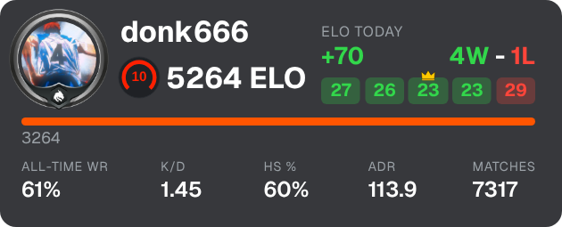
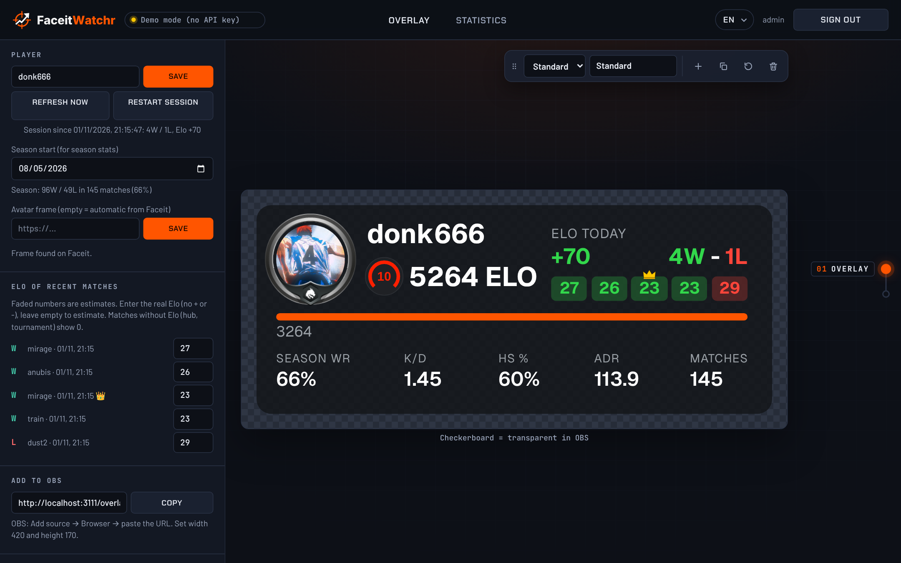
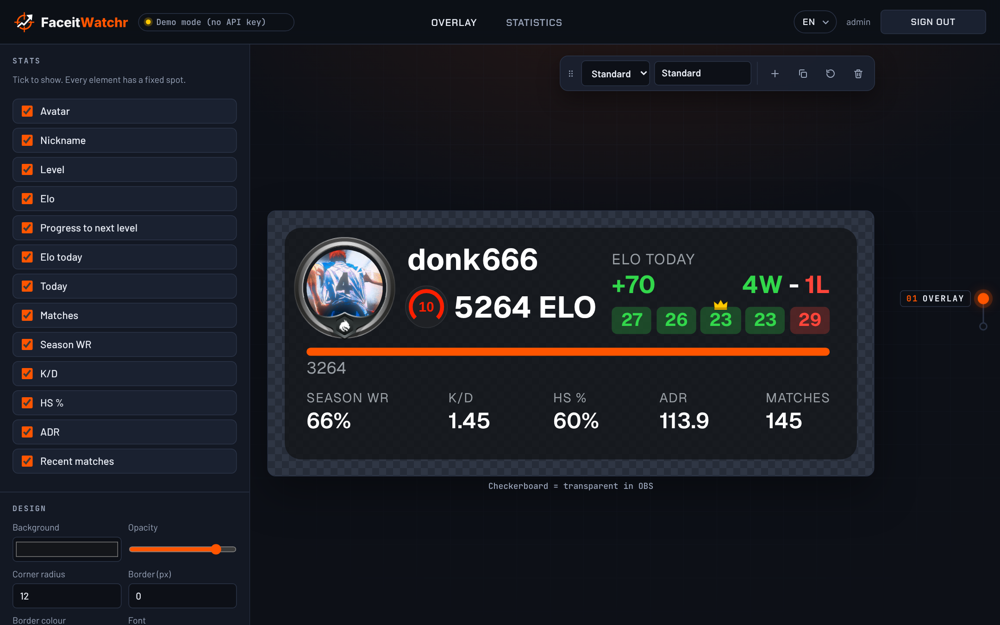
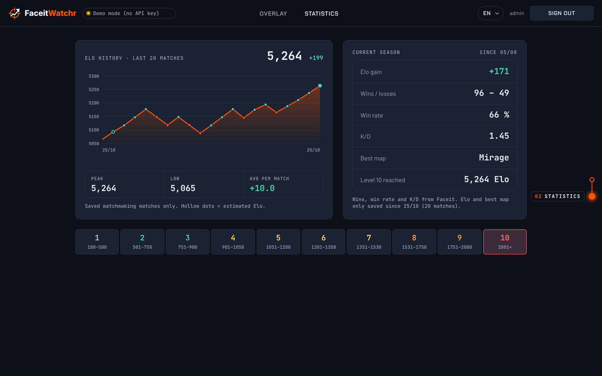

<h1>
  <picture>
    <source media="(prefers-color-scheme: dark)" srcset="public/logo-animated.svg">
    
  </picture>
</h1>

Build your own Faceit overlays (Elo, level, K/D, session stats, …) for OBS and host them yourself. The server polls Faceit and stores your statistics, you design the overlay in the editor, and OBS shows it as a browser source.

<p align="center">
  
</p>

## What it looks like

**Editor:** switch stats on or off, pick colours and font, copy the OBS link.



**Pick your stats:** every stat can be shown or hidden on its own, each one has a fixed spot. Fonts and colours are set under **Design**.



**Statistics:** Elo history of your last 20 matches, the current season and all Faceit levels at a glance.



The screenshots use the stats of donk (Faceit donk666, as of Oct 25, 2026), played back in demo mode. The editor is available in English, German, Russian and French.

## Requirements

- [Node.js](https://nodejs.org) 22.13 or newer
- A Faceit API key (without a key everything runs in demo mode with sample data)

## Getting a Faceit API key

1. Log in at [developers.faceit.com](https://developers.faceit.com).
2. Create an app in the **App Studio**.
3. Under **API Keys**, create a key of type **Server side**.

## Setup and start

```bash
git clone https://github.com/Fersehet/FaceitWatchr.git
cd FaceitWatchr
npm install
cp .env.example .env   # Windows: copy .env.example .env
```

Put at least this into `.env`:

```env
FACEIT_API_KEY=your-key
ADMIN_PASSWORD=a-long-password
```

Then start it:

```bash
npm start
```

Open **http://localhost:3000** in your browser and sign in with user `admin` and your password. Enter your Faceit nickname in the editor and design your overlay.

## Adding it to OBS

1. In the editor under **Add to OBS**, copy the URL, e.g. `http://localhost:3000/overlay/abcd1234`.
2. In OBS choose **Add source → Browser** and paste the URL.
3. Set width 420 and height 170.

If the server runs on another machine, use its IP instead of `localhost`. Overlays can be read without signing in, the editor cannot.

## Troubleshooting

- **The editor shows "Demo mode (no API key)":** the server found no key. The console window says why when it starts. Check that `.env` has a line `FACEIT_API_KEY=your-key` and restart the server. On Windows, make sure the file is called `.env` and not `.env.txt`.
- **The sign-in page says login is not set up:** put `ADMIN_PASSWORD` into `.env` and restart the server.
- **"Too many attempts":** after 10 wrong passwords the login is locked for up to 15 minutes.
- **The editor says the API key is invalid:** create a new key of type **Server side** at [developers.faceit.com](https://developers.faceit.com) and put it into `.env`.
- **The editor says the player was not found or has no CS2 profile:** check the spelling of your Faceit nickname in the editor.
- **The editor says the rate limit was reached:** set a higher `POLL_INTERVAL_SECONDS` in `.env` (default 60).
- **Nothing shows up in OBS:** open the OBS URL in your browser. If it stays empty there, copy the URL again from the editor under **Add to OBS**. If the server runs on another machine, use its IP instead of `localhost`.
- **The overlay is cut off in OBS:** set the width of the Browser source to 420 and the height to 170.
- **Changes don't show up after an update:** an old server may still be running in the background and holding port `3000`. Close every terminal running `npm start` (or end the `node` processes), then run `npm start` once. If the port is used by something else, set another one, e.g. `PORT=3001` in `.env`.
- **The Elo of a match looks wrong:** if Faceit's Elo history can't be read, or several matches ended between two checks, the Elo is estimated and shown faded. Enter the real Elo under **Elo of recent matches** in the editor. Hub and tournament matches without Elo show 0.

## Updating

```bash
git pull
npm install
npm start
```

Your overlays and statistics live in `data/` and are kept. More settings (port, poll interval, storage location) are listed in `.env.example`.
